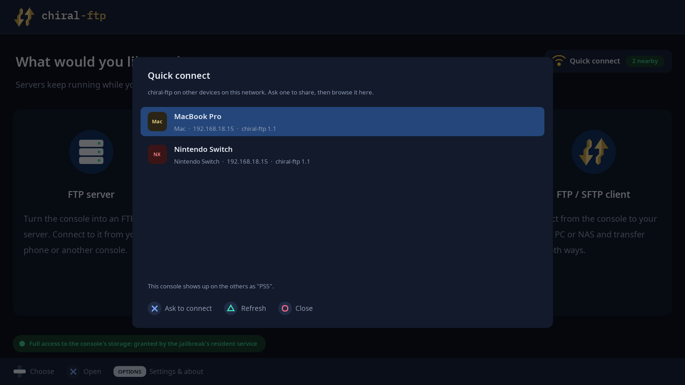
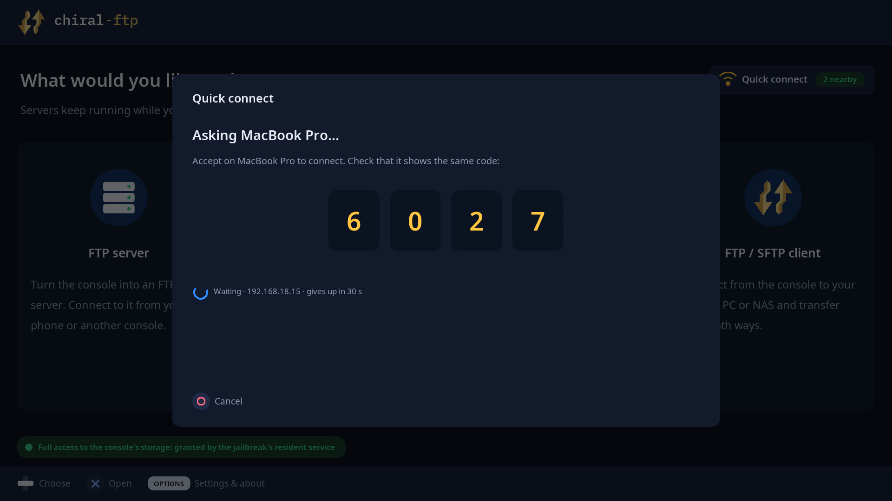
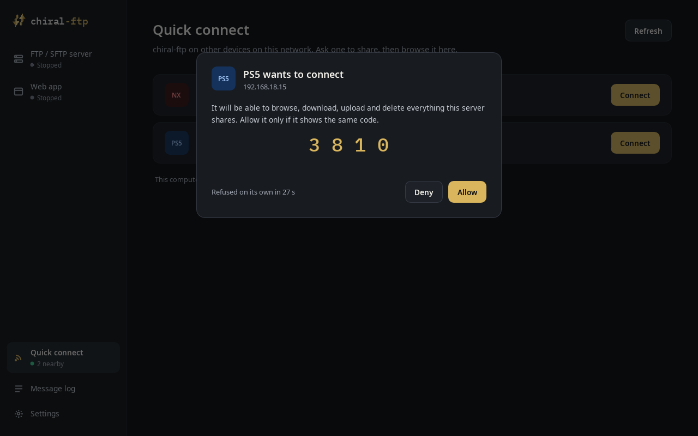
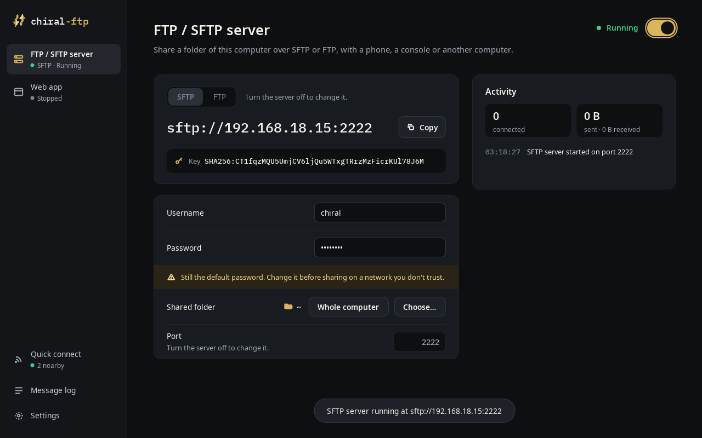
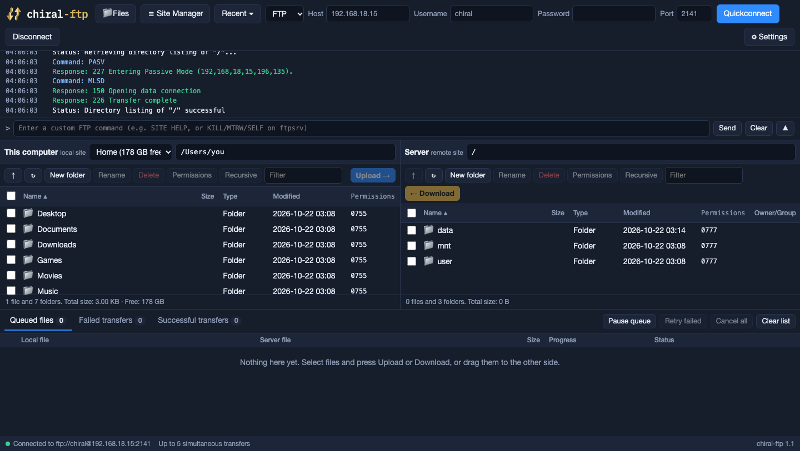
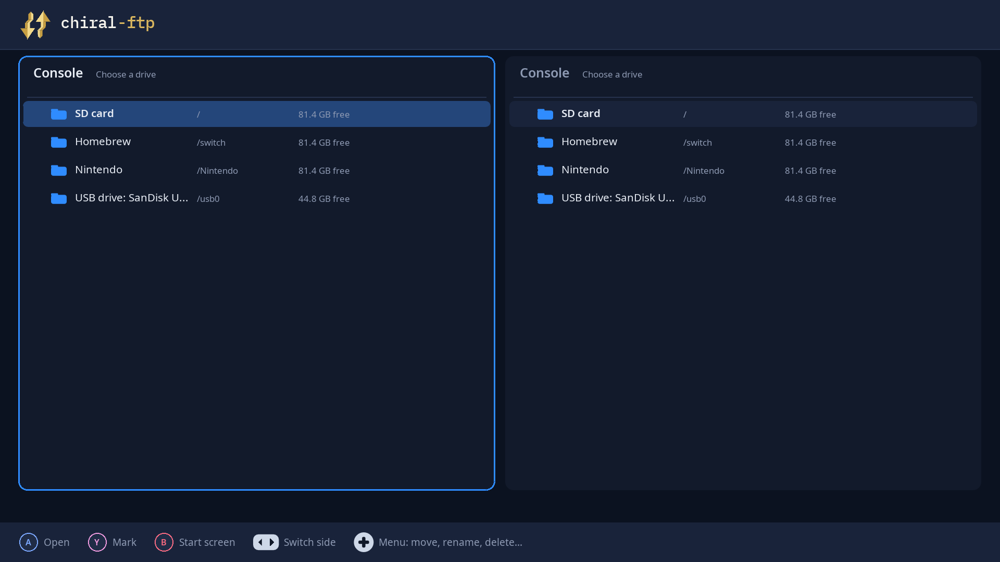
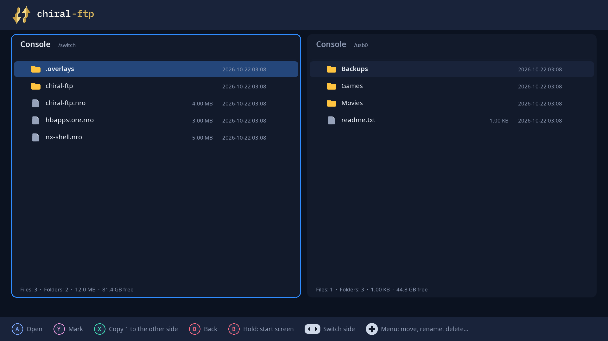
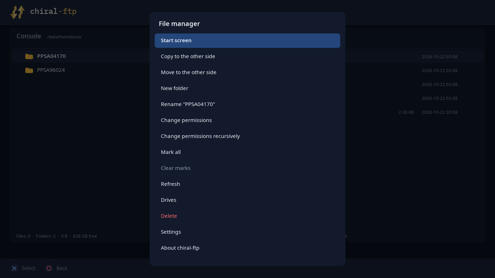
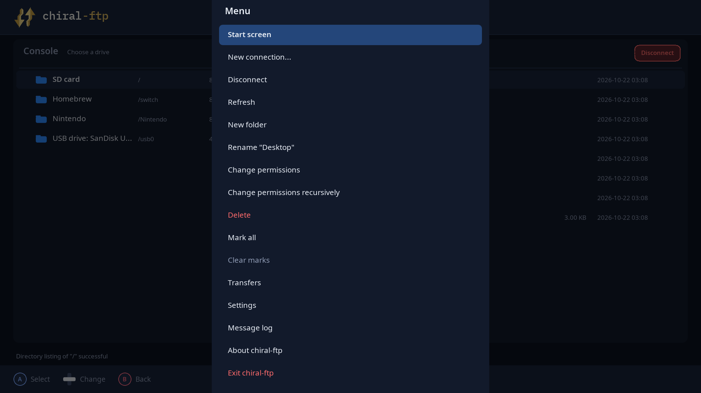

# Changelog

## 1.1

chiral-ftp now has downloads for **Windows**, **Mac** and **Linux**, next to
the **PS5** and the **Nintendo Switch**. And every copy of chiral-ftp on
your network can now find and open the others in two presses: **Quick
connect**.

### New: Quick connect

| On the PS5 | On a Mac |
|---|---|
|  |  |
|  |  |

- **Every copy of chiral-ftp on your network shows up**, whatever it is
  doing: no server has to be running, and nothing has to be set up.
- **Ask one to share.** It shows your request with a 4-digit code; check
  it's the same code on both screens and press **Allow**. The other device
  starts its server, and you are connected and browsing it.
- **The login it hands out works only from the device that asked**, and only
  while that server runs. Deny, or let the request time out, and nothing is
  shared.
- On a console, Quick connect is on the start screen (press **Up**) and runs
  while chiral-ftp is open there. On a computer it's in the sidebar (or
  **⌘K** on a Mac) and runs whenever the app is open.
- The list stays current even on Wi-Fi that drops broadcasts.

### New: Windows, Mac and Linux

| The app on a computer | The web app, in your browser |
|---|---|
|  |  |

- **Windows**: one `.exe` (x64; it runs on Windows on ARM too), nothing to
  install. **Mac**: `chiral-ftp.app`. Double-click it, or drag it to
  Applications; it carries its own libraries. **Linux**: one `.AppImage`
  file.
- **Made for a computer** (Windows, Mac and Linux alike): a sidebar with
  the server, the web app, Quick connect, the message log and Settings, each
  a page with ordinary switches, fields and buttons; on a Mac the menu bar
  has everything, with shortcuts.
- **The mouse works everywhere**: hover, click, right-click, scroll, and
  click outside a panel to close it.
- **Sharp text**: the layout follows the window instead of scaling a fixed
  screen, and text is rendered with hinting.
- **SFTP server** (encrypted, the default) or FTP, on the same screen.
- **Shares your home folder** by default. **Whole computer** shares
  everything, after a confirmation. chiral-ftp's own settings (saved
  passwords, the server's login and its private key) are never shared,
  whatever folder is.
- **The web app opens in your browser.** By default only this computer can
  reach it; switch "Reachable from" to your home network to use it from a
  phone or another device.
- **Network**: when a computer is on several networks (Wi-Fi, Ethernet, a
  VPN), Settings > Network chooses the address to show. Automatic prefers
  your home network.
- On a computer, the file manager and the FTP / SFTP client are in the web
  app, in your browser.

### New on the Switch: USB drives

| The drive list | The SD card and a USB drive, side by side |
|---|---|
|  |  |

- **USB drives show up in the drive list** as soon as they're plugged in:
  FAT32, exFAT, NTFS and ext2/3/4. Browse, copy and move between them and
  the SD card in the file manager, and reach them over the FTP server
  (`/usb0`) and the web app.
- **Free space is shown again** for the SD card and for USB drives.

### New on the PS5

- **Free space is shown** for the internal storage, an M.2 drive and USB
  drives.
- The start screen says how the app got full storage access (the
  jailbreak's resident service, or the Lapy helper), or why it didn't.

### Everywhere

| File manager menu (PS5) | Client menu (Switch) |
|---|---|
|  |  |

- **Change permissions recursively**: a folder and everything inside it,
  as its own entry next to Change permissions (client, file manager and web
  app). Folders keep x wherever they get r, so they stay openable.
- **Uploads to a PS5 homebrew folder end up 777** (files and folders, any
  path with `/data/homebrew` in it, whichever FTP server the PS5 runs), so
  homebrew copied from another device starts.
- **Rename, permissions and Delete for folders** in the client's menu on
  consoles (OPTIONS on the PS5, Plus on the Switch), for the item under the
  cursor or everything marked.
- **A server that stops answering is let go after 30 seconds**: the client
  says the connection was lost and closes, instead of still saying
  "Connected to…".

### Fixes

- **Switch: closing chiral-ftp during a transfer no longer crashes it**:
  transfers are stopped and waited for before the app exits.
- **Switch: tapping a card no longer opens Quick connect** when the
  controller's focus was on the Quick connect button.
- **Client: pressing Open again while a folder is loading** no longer sends
  the same request again behind the first.
- **Client: the loading spinner no longer covers Disconnect.**
- **Long drive names** no longer run into the path next to them.
- **Computers: folders made by the server, the web app or the file manager
  can be opened** (they were created without the x bit).
- **PS5: the start screen showed the Switch's wording** for full access.

## 1.0.1

chiral-ftp is now cross-platform. The same app runs on the **PS5**, the
**Nintendo Switch** (new) and on **PC and Mac**, from one codebase. Support
for Android, PS4 and other platforms is coming soon.

### New: Nintendo Switch

The first release for the Switch, as homebrew (`.nro`) started from hbmenu.
Everything the PS5 version does is there:

- **FTP server**, **web app**, **file manager** (the SD card) and
  **FTP / SFTP client** with saved sites, history, resume and up to 30
  transfers at once.
- Controls follow the PS5 layout by position: **A** opens, **B** goes back,
  **Y** marks, **X** transfers, **R** switches sides, **Plus** opens the
  menu and **Minus** shows the transfer queue. The bottom bar shows the
  Switch's own buttons.
- **The touch screen works**: tap a row, a card, a menu item or a setting,
  drag a list to scroll, tap outside a menu to close it.
- Text is typed with the system keyboard.
- Sleep is held off and the HOME menu can't close the app while it runs,
  so a transfer isn't cut short.
- The start screen says whether the app got the console's full memory
  (launched over a game, holding **R**) or the album's smaller share.
- English, Spanish, French, Italian and Russian.
- Settings, saved sites and history are kept in `/switch/chiral-ftp`.

### New: PC and Mac

The same app in a window on Windows, macOS or Linux, with the keyboard or
a game controller. There's no download yet: build it from source with
`make PLATFORM=sdl` (see the README).

### PS5

- **Creating, renaming, moving, deleting and uploading files no longer fail
  on folders the app isn't allowed to change** (755 or 766 ones, for
  example): chiral-ftp sets the folder to 777 and tries again. This works in
  the file manager, the web app, the FTP server and the client.
- **Change permissions works again.**
- **New folder and rename work in the two-pane file manager**: the PS5
  keyboard is loaded before the app asks for full storage access. If the
  keyboard still can't open, the app says so instead of doing nothing.
- **Hold Circle** to go back to the start screen from anywhere.
- **Faster drawing**: menus and lists respond more quickly to the
  controller.
- The FTP server notices when its connection died while the console slept,
  instead of claiming to still be running.
- In the client, **Disconnect** is on the server pane while connected.

### Everywhere

- The About screen says which platforms chiral-ftp runs on, and thanks the
  projects each version is built with.
- **The FTP server's default login is now `chiral` / `ftp`** on every
  platform. A login you already set is kept; "Reset to chiral / ftp" on the
  FTP server screen switches to the new one.

### Downloads

- `chiral-ftp-ps5-1.0.1.zip`: the PS5 title (`PPSA96024`). Close chiral-ftp
  before you replace it; your settings in `/data/chiral-ftp` are kept.
- `chiral-ftp.nro`: the Switch homebrew. Copy it into `/switch` on the SD
  card; to update, replace it.

## 1.0

The first release of chiral-ftp: the ultimate file manager and FTP interface
for PS5. It runs as a native homebrew title from the dashboard (via
ShadowMountPlus) and is used with the controller on the TV.

### What's in it

- **FTP server.** Other devices connect to the PS5 with FileZilla, a file
  manager or any FTP app. The screen shows the address and login; change the
  username, password or port, or allow anonymous logins. Live activity:
  connected clients, transfers and speed.
- **Web app.** Open the address it shows in a browser on your PC or phone:
  browse the PS5's files, download them, upload from the browser (drag and
  drop works), copy, move, rename and delete. The FTP client is there too.
- **File manager.** Two panes for copying and moving files on the PS5:
  internal storage, Homebrew, USB drives and extended storage. Copies run in
  the background with progress; a folder is deleted with everything inside.
- **FTP / SFTP client.** Connect to a laptop, PC or NAS and transfer both
  ways: saved sites and recent connections, resume, and up to 30 transfers
  at once (5 by default).
- **Full storage access.** At start, chiral-ftp asks the jailbreak for access
  to the console's real storage (OnionHEN, a resident Lapy, or the packaged
  Lapy helper sent to elfldr on port 9021), the way ProsperoEden does.
- **Every file chiral-ftp writes to the PS5 is 777**, so homebrew you copy
  starts. Files it uploads to a server are set to 777 there too when the
  server allows it.
- **Nine languages:** English, Spanish, French, Italian, Japanese, Korean,
  Chinese, Russian and Arabic, with a language selector in Settings
  ("Automatic" follows the PS5's system language). Japanese, Korean, Chinese
  and Arabic use the PS5's own system fonts.
- Servers and transfers keep running while you use another mode or go to the
  PS5 home screen.

### Requirements

- A jailbroken PS5 with ShadowMountPlus, and an ELF loader (elfldr) on port
  9021 when chiral-ftp starts.
- Tested on PS5 firmware 13.60.

### Known limitations

- Closing chiral-ftp stops its servers and transfers.
- There is no SFTP server yet (the FTP server is plain FTP).
- The web app has no login: anyone on your network can use it while it runs.
- The technical message log and the web pages are in English.
- Arabic text reads right to left, but the screen layout stays left to right,
  and Arabic file names aren't joined.
- Free space on drives isn't shown.
