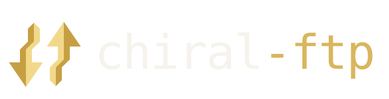
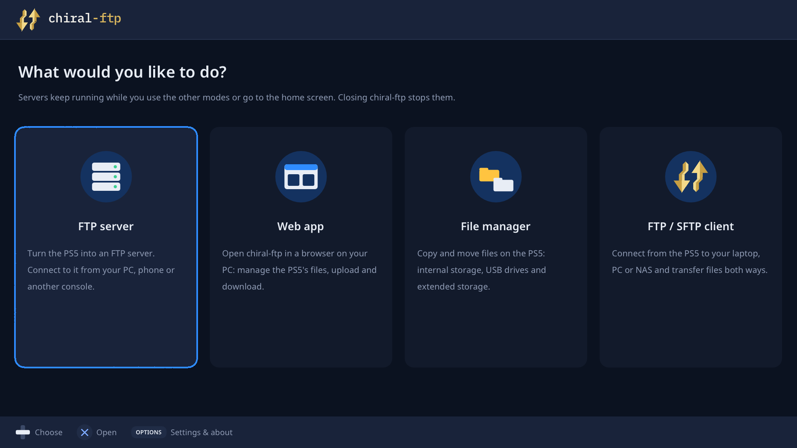
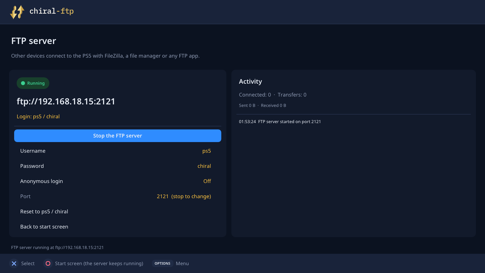
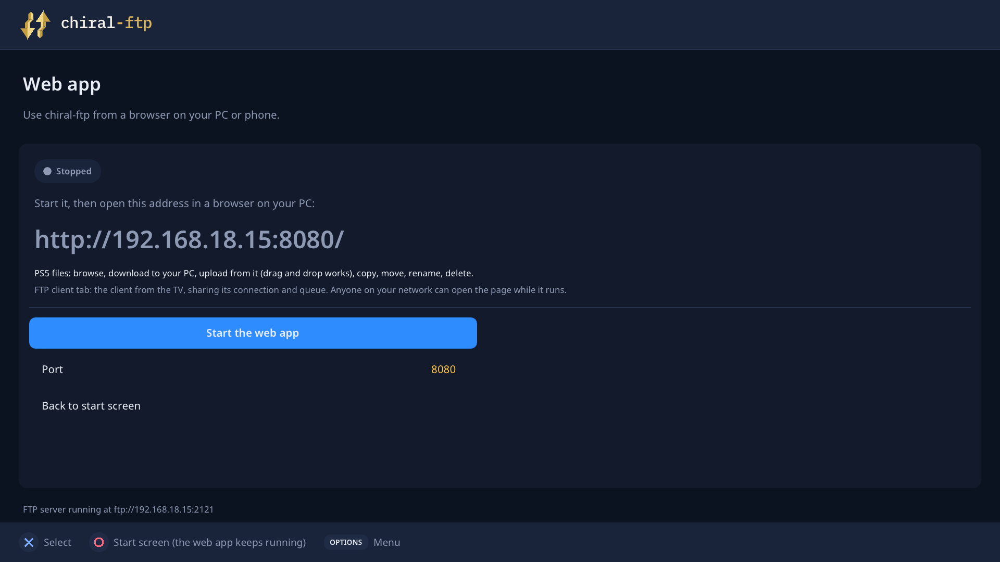
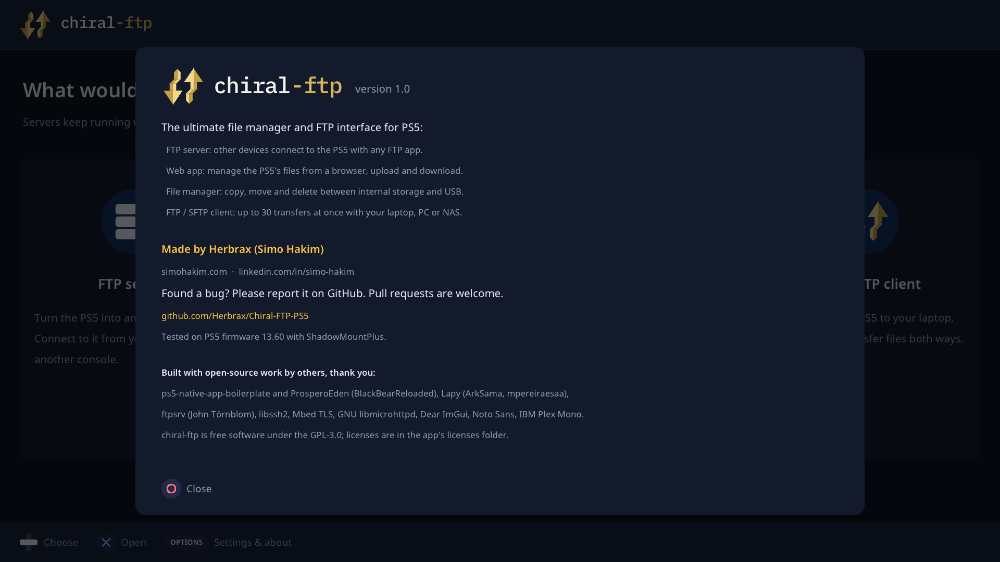
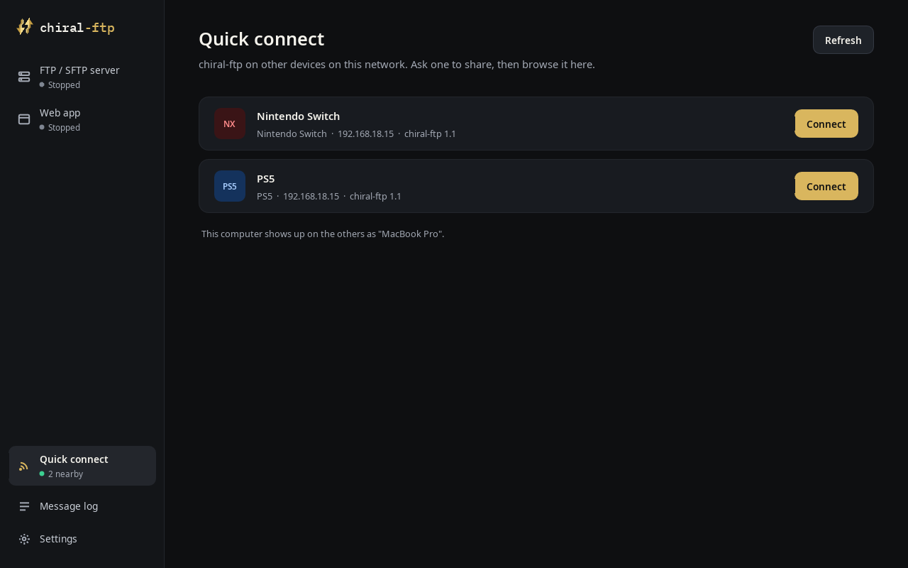
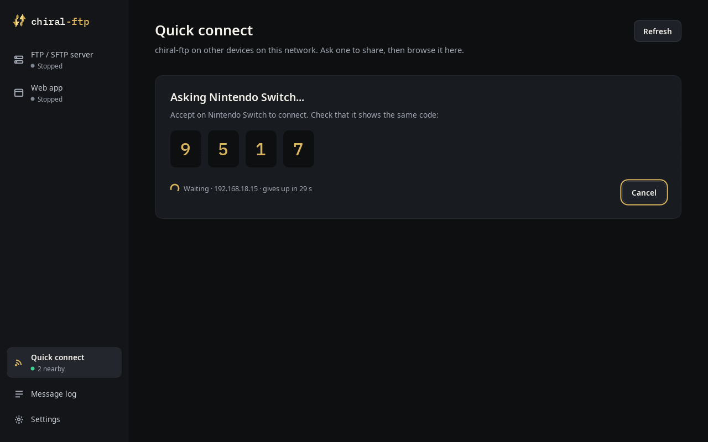
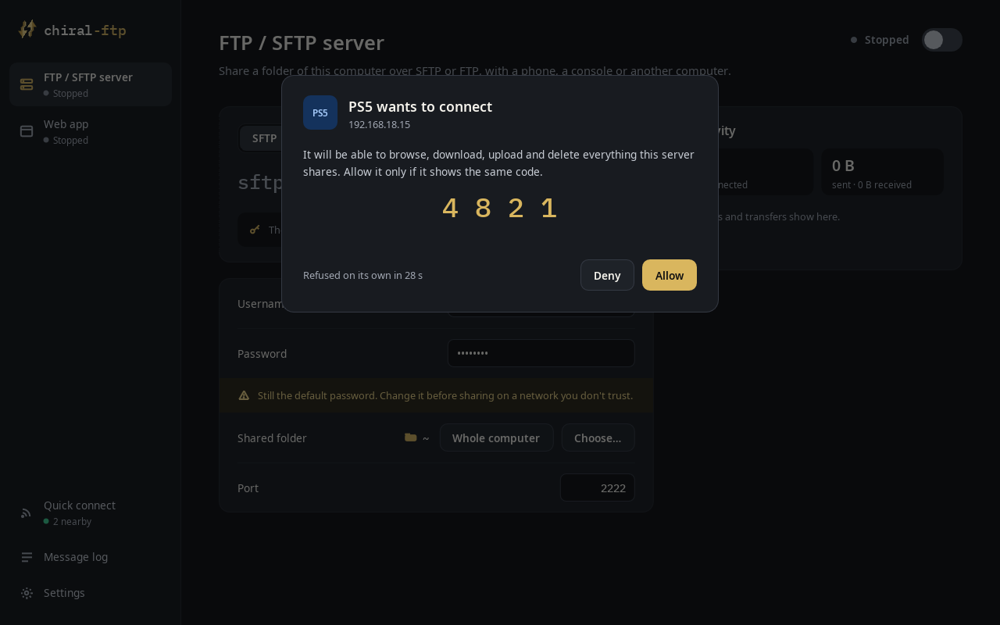

<p align="center"></p>

<p align="center">
  <a href="https://github.com/Herbrax/chiral-ftp/releases"></a>
  <a href="https://github.com/Herbrax/chiral-ftp/stargazers"></a>
</p>

# chiral-ftp

**The ultimate file manager and FTP interface, on every machine you own.**
chiral-ftp is cross-platform: it runs on the **PS5**, the **Nintendo Switch**,
the **Mac** and **Linux**. It's used with a controller on the TV (or a
keyboard and mouse on a computer) and works in the spirit of FileZilla. And
every copy finds the others on your network: **Quick connect** opens one
from another in two presses.

| | |
|---|---|
| **PS5** | a native title on the dashboard, via ShadowMountPlus |
| **Nintendo Switch** | homebrew (`.nro`) from hbmenu |
| **Mac** | `chiral-ftp.app` (macOS 27 or later, Apple silicon) |
| **Linux** | an `.AppImage` |
| **Windows** | coming soon |

**Windows** is next; Android, PS4 and other platforms after it.

When it opens, you choose what to do:

- **FTP server**: turn the console into an FTP server. The screen shows the
  address and login; change the username, password or port, or allow
  anonymous logins. Connected clients, transfers and speed are shown live.
- **Web app**: open chiral-ftp in a browser on your PC or phone. Browse the
  console's files, download them, upload from the browser (drag and drop
  works), copy, move, rename and delete. An FTP client tab is also there.
- **File manager**: two panes for copying and moving files: internal
  storage, Homebrew, USB drives and extended storage on the PS5; the SD card
  and USB drives on the Switch. Free space is shown for each drive.
- **FTP / SFTP client**: connect to a laptop, PC or NAS and transfer both
  ways. Saved sites and recent connections, resume, and up to 30
  simultaneous transfers (5 by default).
- **Quick connect**: see the other copies of chiral-ftp on your network and
  browse one of them, with a code to confirm on its screen. See
  [Quick connect](#quick-connect).

The servers keep running while you use another mode. Closing chiral-ftp
stops them.

| | |
|---|---|
|  |  |
|  |  |

What's new in each version is in [CHANGELOG.md](CHANGELOG.md).

## Languages

Settings → Language; "Automatic" follows the system language.

| | PS5 | Switch | Mac and Linux |
|---|:---:|:---:|:---:|
| English, Spanish, French, Italian, Russian | ✓ | ✓ | ✓ |
| Japanese, Korean, Chinese, Arabic | ✓ | | ✓ |

## PS5

**Requirements**

- A jailbroken PS5 with **ShadowMountPlus** and an **ELF loader (elfldr)
  listening on port 9021** when chiral-ftp starts. chiral-ftp uses it to get
  full access to the console's storage (see Lapy under [Thanks](#thanks));
  without it, the app only sees its own sandbox.
- Tested on PS5 firmware **13.60**. Other firmware may work but hasn't been
  tested.

**Install**

1. Download `chiral-ftp-ps5-1.1.zip` from the releases and unpack it. It
   contains the folder `PPSA96024`.
2. Copy that folder to `/data/homebrew/PPSA96024` on the PS5.
3. Make sure the folder and **every file in it are 777**. The PS5 refuses to
   start a title otherwise ("can't start the game or app"). The zip stores
   all modes as 777, but some FTP clients don't keep them.
4. Start chiral-ftp from the dashboard. The start screen should say "Full
   access to the console's storage", and how it was granted.

**Updating:** close chiral-ftp completely before you replace its files. Most
FTP clients overwrite `eboot.bin` in place, and the console silently refuses
that while the title is in use. Upload it under another name and rename it
over the old one, or use `make PLATFORM=ps5 deploy` (see
[Building](#building)).

Settings, saved sites and history are kept in `/data/chiral-ftp`, so updates
keep them. Every file chiral-ftp writes to the PS5 is set to 777, so homebrew
you copy starts; files it uploads to a server are set to 777 there too, when
the server allows it.

## Nintendo Switch

**Requirements:** a Switch running custom firmware (Atmosphère) with
**hbmenu**.

**Install**

1. Download `chiral-ftp.nro` from the releases.
2. Copy it into `/switch` on the SD card. To update, replace it.
3. Start it from hbmenu.

Started from the album, homebrew runs with its memory capped near 448 MB.
That is enough for chiral-ftp, but for the console's full memory hold **R**
while launching a game and pick chiral-ftp from the menu that opens. The
start screen says which one you got.

**USB drives** show up in the drive list as soon as they're plugged in
(FAT32, exFAT, NTFS and ext2/3/4), as `/usb0`, `/usb1`…, in the file
manager, over the FTP server and in the web app.

Settings, saved sites, history and host keys are kept in
`/switch/chiral-ftp`, so updates keep them.

## Mac and Linux

**Mac**

1. Download `chiral-ftp.app` from the releases.
2. Drag it to Applications. It carries its own libraries.
3. The app isn't notarized by Apple, so the first time macOS says it can't
   check it: open **System Settings > Privacy & Security** and choose
   **Open Anyway** (or run `xattr -dr com.apple.quarantine
   /Applications/chiral-ftp.app` once).

It needs **macOS 27 or later on Apple silicon**, and keeps its settings in
`~/Library/Application Support/chiral-ftp`.

**Linux**

1. Download `chiral-ftp-1.1-x86_64.AppImage` from the releases.
2. Make it executable (`chmod +x chiral-ftp-1.1-x86_64.AppImage`) and run it.

It keeps its settings in `~/.local/share/chiral-ftp`.

**Windows** is coming soon.

On a Mac, the window has a sidebar instead of a start screen: the server,
the web app, Quick connect, the message log and Settings, each a page with
ordinary switches, fields and buttons. On Linux the window keeps the console
layout. Either way, on a computer chiral-ftp is a server first:

- **FTP / SFTP server**: shares your home folder over SFTP, or FTP if you
  switch the protocol. **Choose…** shares another folder; **Whole
  computer** shares everything, after a confirmation. chiral-ftp's own
  settings (saved passwords, the server's login and its key) are never
  shared. SFTP is on port 2222; an app connecting the first time asks you to
  trust the key shown on the screen.
- **Web app**: the file manager and the FTP / SFTP client, opened in your
  browser. By default only this computer can reach it; switch "Reachable
  from" to your home network to use it from a phone or another device.
- **Network**: on a computer with several networks (Wi-Fi, Ethernet, a VPN),
  Settings > Network chooses the address shown. Automatic prefers your home
  network.

To build it yourself instead, see [Building](#building): `make
PLATFORM=sdl` (it needs libssh, `brew install libssh`, for the SFTP server),
then `make PLATFORM=sdl app` for the Mac app.

## Quick connect

Every copy of chiral-ftp on your network shows up in every other one, PS5,
Switch, Mac or Linux alike, whatever it's doing. Nothing has to be running
and nothing has to be set up.

1. **Open Quick connect.** On a console: press **Up** on the start screen.
   On a computer: **Quick connect** in the sidebar (**⌘K** on a Mac). The
   devices nearby are listed, with their names and addresses.

   

2. **Pick one and press Connect.** Your screen shows a 4-digit code while it
   waits.

   

3. **On the other device, check the code and press Allow.** It starts its
   server and hands your device a login of its own. You're connected and
   browsing its files: in the client on a console, in the web app on a
   computer.

   

The login it hands out works **only from the device that asked**, and only
while that server runs. **Deny**, or let the request run out (30 seconds),
and nothing is shared. A console is visible while chiral-ftp is open on its
start screen; a computer, whenever the app is open. Quick connect uses UDP
port 47121 on your local network.

## Using it

| | PS5 | Switch | Keyboard |
|---|---|---|---|
| Move | D-pad / sticks | D-pad / sticks | Arrow keys |
| Open or select | Cross | A | Enter |
| Back | Circle | B | Esc |
| Menu | OPTIONS | Plus | M |
| Mark | Square | Y | Space |
| Copy / transfer the marked items | Triangle | X | T |
| Switch sides | R1 | R | Tab |
| Transfer queue | Touchpad | Minus | G |

A game controller works on a computer too, with the same layout. So does
the mouse: what it is over is highlighted, a click opens it, a right click
opens the menu, the wheel scrolls, and clicking outside a panel closes it.
On a Mac, the menu bar has the server (⌘1), the web app (⌘2), Quick connect
(⌘K), Settings (⌘,), Transfers (⌘T) and the message log (⌘L).

- Every screen's menu starts with **Start screen**, which always brings you
  back; holding **Back** does the same. On the start screen, the menu opens
  Settings and About.
- On the Switch, the touch screen works as well: tap to select, drag to
  scroll.
- Text is typed with the system keyboard.

**Security.** The FTP server and the web app run on your local network. The
FTP server's login is shown on its screen: change it from the default. The
web app has no login: anyone on your network can use it while it runs, so
stop it when you're done. Both can change anything on the console's storage.

## Known gaps

- **Windows**: no download yet; it's coming.
- **Switch: save data and system storage** (NAND) aren't reachable.
- **The SFTP server is on computers only**; the consoles' server is FTP.
- **Mac**: macOS 27 or later on Apple silicon only, and not notarized
  (see [Mac and Linux](#mac-and-linux)).

## Building

```sh
make PLATFORM=sdl          # ./chiral-ftp, a window on this computer (default)
make PLATFORM=ps5          # dist/PPSA96024/ and its zip
make PLATFORM=switch       # dist/chiral-ftp/chiral-ftp.nro
make PLATFORM=ps5 release     # adds the PS5 zip to release/, with SHA256SUMS
make PLATFORM=switch release  # and the Switch .nro; the notes cover both
make test                  # unit tests, and a check that every platform is complete
```

Everything shared lives in `engine/`, `web/` and `app/`; what differs lives
in `platform/<name>/`. [docs/LAYOUT.md](docs/LAYOUT.md) explains how, and
[docs/PORTING.md](docs/PORTING.md) is the history of getting there.

**PS5** is built on macOS (Linux should work with minor changes) with the
tooling of
[ps5-native-app-boilerplate](https://github.com/blackbearreloaded/ps5-native-app-boilerplate),
included in `ps5/`:

1. `brew install llvm@18 coreutils gnu-sed bash cmake sdl2 libmicrohttpd`
2. Build the boilerplate's tooling once: `cd ps5 && make` (on macOS, the
   wrappers in `ps5/.hostbin` and the Homebrew GNU tools must be on `PATH`).
3. `make PLATFORM=ps5`. The first run fetches and builds mbedTLS, libssh2 and
   libmicrohttpd for the PS5 (checksums pinned in `tools/build-ps5-deps.sh`),
   and the Lapy helper.
4. `make PLATFORM=ps5 deploy PS5_HOST=<PS5 IP>` sends the build to the PS5
   through an FTP server that runs outside the app's sandbox (ftpsrv on port
   2121). Only changed files are sent, each is verified and renamed into
   place, and everything is set to 777.

**Switch** needs [devkitPro](https://devkitpro.org/wiki/Getting_Started):

```sh
dkp-pacman -S switch-dev switch-libssh2 switch-mbedtls switch-zlib dkp-toolchain-vars
export DEVKITPRO=/opt/devkitpro
```

devkitPro has no package for libmicrohttpd, which the web app needs, so the
first build cross-compiles it into `.deps/switch` (checksum pinned).
`make PLATFORM=switch WEB=0` leaves the web app out and drops that
dependency.

**PC and Mac** need SDL2, libmicrohttpd and pkg-config, plus
`tools/build-sftp-deps.sh host` for libssh2 and mbedTLS.

**Windows** builds in [MSYS2](https://www.msys2.org): the UCRT64 shell for
x64, CLANGARM64 for arm64 (use `mingw-w64-clang-aarch64-` instead of
`mingw-w64-ucrt-x86_64-` below). Everything is linked statically, so the
result is one `.exe` that needs nothing installed beside it.

```sh
pacman -S make mingw-w64-ucrt-x86_64-{gcc,pkgconf,cmake,ninja,python,SDL2,libmicrohttpd,libssh,freetype}
CMAKE_GENERATOR=Ninja bash -o igncr tools/build-sftp-deps.sh host
make PLATFORM=sdl dist     # dist/chiral-ftp-<version>-windows-x64.exe
make PLATFORM=sdl release  # and adds it to release/
```

The shared code is written against POSIX; `platform/sdl/win32/posix.h`
gives it that on Windows, with paths as MSYS2 writes them (`/c/Users`, and
`/` for the list of drives).

The generators are Python 3; if your `python3` is called something else, pass
it: `make PYTHON=python`. `tools/render-icon.py` regenerates the Switch icon,
and `tools/render-background.sh` the PS5's dashboard background.

**Translations** live in [i18n/translations.json](i18n/translations.json):
every string the app shows, in English and the eight other languages. The
build refuses a string with no entry, a missing language, or a translation
whose placeholders (`{0}`, `%s`) differ from the English. Corrections from
native speakers are very welcome.

## Bugs and contributions

Found a bug? Please [open an issue](https://github.com/Herbrax/chiral-ftp/issues).
Say what you did, what happened, which console (with its firmware and
jailbreak or custom firmware), and if possible the startup log:
`/data/chiral-ftp/startup.log` on the PS5, `/switch/chiral-ftp/startup.log`
on the Switch. [Pull requests](https://github.com/Herbrax/chiral-ftp/pulls)
are welcome.

## Thanks

chiral-ftp stands on the work of others. Thank you:

**PS5**

- **[ps5-native-app-boilerplate](https://github.com/blackbearreloaded/ps5-native-app-boilerplate)**
  by BlackBearReloaded. It is how chiral-ftp exists as a native dashboard
  title at all. We use its toolchain unchanged (included in `ps5/`): the
  compiler wrapper, the link script and program startup code, the tool that
  converts and signs `eboot.bin`, and its clean-room `libc.prx` runtime,
  which ships in `sce_module/`. The code that sets up the TV display follows
  its VideoOut example, and its notes on what a sandboxed title may and may
  not do (sockets, `fcntl`, name lookups) saved us a lot of trial and error.
- **[ProsperoEden](https://github.com/blackbearreloaded/ProsperoEden)** by
  BlackBearReloaded and contributors. Its storage access client
  (`platform/ps5/elevation/`) is used as is, with one change: chiral-ftp also
  checks that the app really became root before trusting what it can see. We
  also follow its approach to listing folders on the PS5 (reading
  directories with `sceKernelGetdents` and a large buffer), its link recipe
  for the C++ runtime, and how it talks to the system keyboard.
- **[PS5-Lapy-JB-Daemon](https://github.com/ArkSama/PS5-Lapy-JB-Daemon)**
  (Lapy) by ArkSama, with the cooperative one-shot helper from
  [mpereiraesaa's fork](https://github.com/mpereiraesaa/PS5-Lapy-JB-Daemon),
  pinned through BlackBearReloaded's fork. The packaged `lapy.elf` is built
  from their unmodified source; at startup chiral-ftp sends it to the ELF
  loader, and it gives the app access to the console's real storage. That is
  what lets the file manager, the FTP server and the web app reach your
  files.
- The **[PS5 Payload SDK](https://github.com/ps5-payload-dev/sdk)**: its
  compiler, linker and system libraries build the PS5 app, its libraries
  and the Lapy helper.

**Switch**

- **[libnx](https://github.com/switchbrew/libnx)** and
  **[devkitPro](https://devkitpro.org)** by the switchbrew authors, fincs,
  WinterMute and contributors. The whole console layer is libnx: the
  framebuffer, the controllers and touch screen, the system keyboard, the
  fonts and the network, plus the toolchain and libraries the app is built
  with.
- **[ftpd](https://github.com/mtheall/ftpd)** by Michael Theall. Its
  `source/switch/init.c` is where the Switch's service startup comes from:
  which services to open, holding off sleep and exit while a transfer runs,
  and the network buffer settings that make transfers fast.
- **[NX-Shell](https://github.com/joel16/NX-Shell)** by Joel16, the model for
  how the app uses the system keyboard and the SD card.
- **[libusbhsfs](https://github.com/DarkMatterCore/libusbhsfs)** by
  DarkMatterCore, built into the Switch app, with
  **[NTFS-3G](https://github.com/tuxera/ntfs-3g)** and
  **[lwext4](https://github.com/gkostka/lwext4)**: they read USB drives
  (FAT, exFAT, NTFS, ext2/3/4).

**Everywhere**

- **[websrv](https://github.com/ps5-payload-dev/websrv)** by John Törnblom.
  The web app's embedded-file server comes from it: `web/asset.c`,
  `web/asset.h` and `tools/gen-asset-module.py`, which turn the web pages
  into C arrays served from memory (we added compressed files). Our
  libmicrohttpd setup follows websrv and
  [ps5-web-file-manager](https://github.com/owendswang/ps5-web-file-manager).

Also: [ftpsrv](https://github.com/ps5-payload-dev/ftpsrv) by John Törnblom,
whose command set our FTP server follows (our code is written separately);
[FileZilla](https://filezilla-project.org), whose behaviour the client
follows; and the libraries built into the app: libssh2, Mbed TLS, GNU
libmicrohttpd, Dear ImGui, Noto Sans and IBM Plex Mono, and on computers
SDL2, libssh (the SFTP server) and FreeType (text).

## License

chiral-ftp is free software under the GNU General Public License v3.0 or
later; see [LICENSE](LICENSE). Files taken from other projects keep their
original copyright headers. The licenses of everything bundled in the app are
in its `licenses` folder (GPL-3.0, LGPL-2.1, MIT, BSD, Apache-2.0, OFL).

Made by **Herbrax** (Simo Hakim): [simohakim.com](https://simohakim.com) ·
[LinkedIn](https://www.linkedin.com/in/simo-hakim/)
